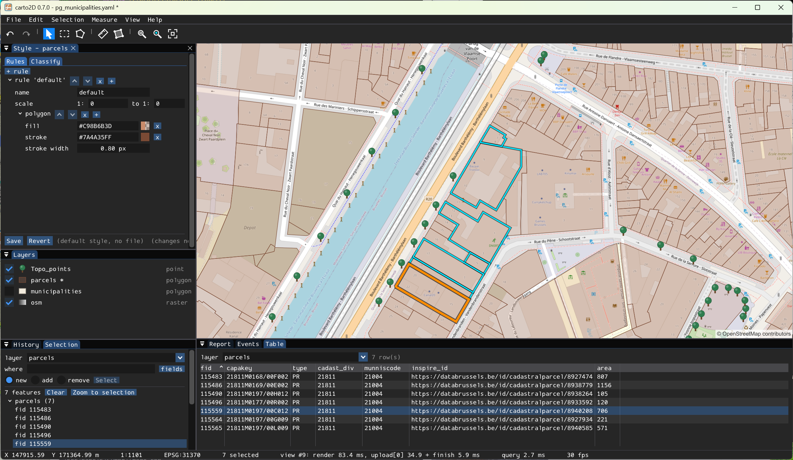
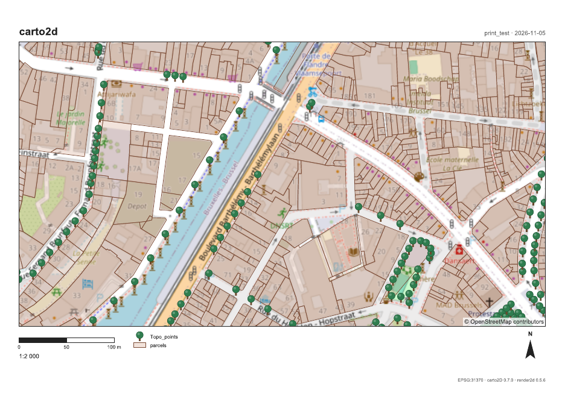

# carto2D

See, query, measure and print maps. A desktop program for Windows and Linux,
built on [render2d](https://github.com/nfr25/render2d), the map renderer it
shares with a command line and a web viewer.

carto2D was named editor2d until version 0.6. It is heading for its 1.0: a
light map program that installs with a double click and does the essentials
well. Editing data will be a separate program, later.



A printed page, at 1:2 000 on an A4:



## What it does

- **Layers** from files (shapefile, GeoPackage, FlatGeobuf, GeoJSON... all
  that GDAL reads), PostGIS tables, rasters (orthophotos, scans), and web
  basemaps (OpenStreetMap, WMS, WMTS), dropped on the window or kept in a
  project file.
- **Reprojection on the fly** (PROJ): every layer in the map's system,
  chosen among PROJ's 5 000 and more by name or by place.
- **Styles** in YSLD (the YAML form of the OGC's SLD, as GeoServer's): edited
  in a dialog with the map as preview; categories and graduated classes made
  from a field; SVG and PNG symbols, with a library of 84 map symbols.
- **Queries**: what is under a click, in a rectangle or a polygon, or what
  matches an expression (`AREA > 500 AND TYPE = 'house'`), shown in a table.
- **Measures** of lengths and areas on the ellipsoid, whatever the map's
  system.
- **Printing**: a PDF page (A4, A3) at an exact scale on the ground, with a
  title, a scale bar, a north arrow towards the true north, the legend of
  what is on the page and the data's attributions.
- **Undo** for everything (Ctrl+Z), and every action is a command written as
  JSON, ready to be driven by a script one day.
  
##installing
## Download

**Windows (64-bit):** [the latest release](https://github.com/nfr25/carto2d/releases/latest),
`carto2D-<version>-setup.exe`. Installed for you alone, without administrator
rights; carto2D opens on Brussels on OpenStreetMap (an Internet connection is
needed for the tiles). A portable zip is there too: unzip it (do not run it
from inside the zip) and start `carto2d.exe`.

The installer is not signed yet: Windows SmartScreen may say "Windows protected
your PC". Click *More info*, then *Run anyway*.

**Linux:** build it from the sources (below); an AppImage will follow.  

## Running

```
carto2d [project.yaml] [data files...]
```

Without a project: an empty map, files can be dropped on it. A project is a
YAML file listing the layers, their styles and the map's system; it is also
read by `render2d --config project.yaml`, which draws the same map, or the
same printed page, without a window.

## Building

The repository includes render2d as a git submodule, at a released version:

```
git clone --recursive https://github.com/nfr25/carto2d.git
cd carto2d
```

**Windows**, with [MSYS2](https://www.msys2.org), in the **UCRT64** terminal:

```
pacman -S --needed mingw-w64-ucrt-x86_64-toolchain mingw-w64-ucrt-x86_64-cmake \
                   mingw-w64-ucrt-x86_64-pkgconf mingw-w64-ucrt-x86_64-cairo \
                   mingw-w64-ucrt-x86_64-gdal mingw-w64-ucrt-x86_64-yaml-cpp make git
```

**Linux** (Debian, Ubuntu):

```
sudo apt install build-essential cmake pkg-config git libgdal-dev libcairo2-dev \
                 libyaml-cpp-dev libx11-dev libxrandr-dev libxinerama-dev \
                 libxcursor-dev libxi-dev libgl-dev
```

Then:

```
make            # Debug build in build/ (GLFW and Dear ImGui are downloaded by CMake)
make run        # build and run build/carto2d
make test       # build and run the tests (no window needed)
make release    # optimized build in build-release/
```

render2d is built inside carto2D's build, libraries only. To build against
another copy of render2d: `make CMAKE_ARGS=-DR2D_DIR=/path/to/render2d/render2d`.
Without the submodule, CMake looks for `../render2d/render2d` beside this
folder.

## The notes
[The design notes](https://nfr25.github.io/carto2d/docs/notions.en.html) ([source](docs/notions.en.html)) are the design document: every
step, written before the code, with its numbers worked out (from Cairo's
pixels to an OpenGL texture, the pixel ratio of a 150 % screen, the scale on
paper, premultiplied colours...), the decisions taken and the ones rejected.
When in doubt, it is the reference.

## Source layout

```
src/
  main.cpp, Application.*   the main loop, the menus, the dialogs' glue
  view/       the map as a texture, navigation, the symbols' textures
  worker/     the render thread (owner of the map), the query thread, PostGIS
  command/    the document, commands, undo history, JSON -> command
  event/      events as JSON
  panels/     Layers, Style, Print, Selection, Table, History, Events...
  window/     GLFW window, ImGui, file dialogs, the platform
tests/        one program per subject, run by ctest
render2d/     the submodule: render2d's repository
```

## Licence

carto2D is free software: GNU Affero General Public License, version 3 or
later (see [LICENSE](LICENSE)), as render2d. Third-party code keeps its
licence: Dear ImGui (MIT), GLFW (zlib), glad (WTFPL or CC0, with Khronos's
Apache-2.0 definitions), nanosvg
(zlib, in render2d). The symbol library's glyphs come from Maki and Temaki
(CC0).
